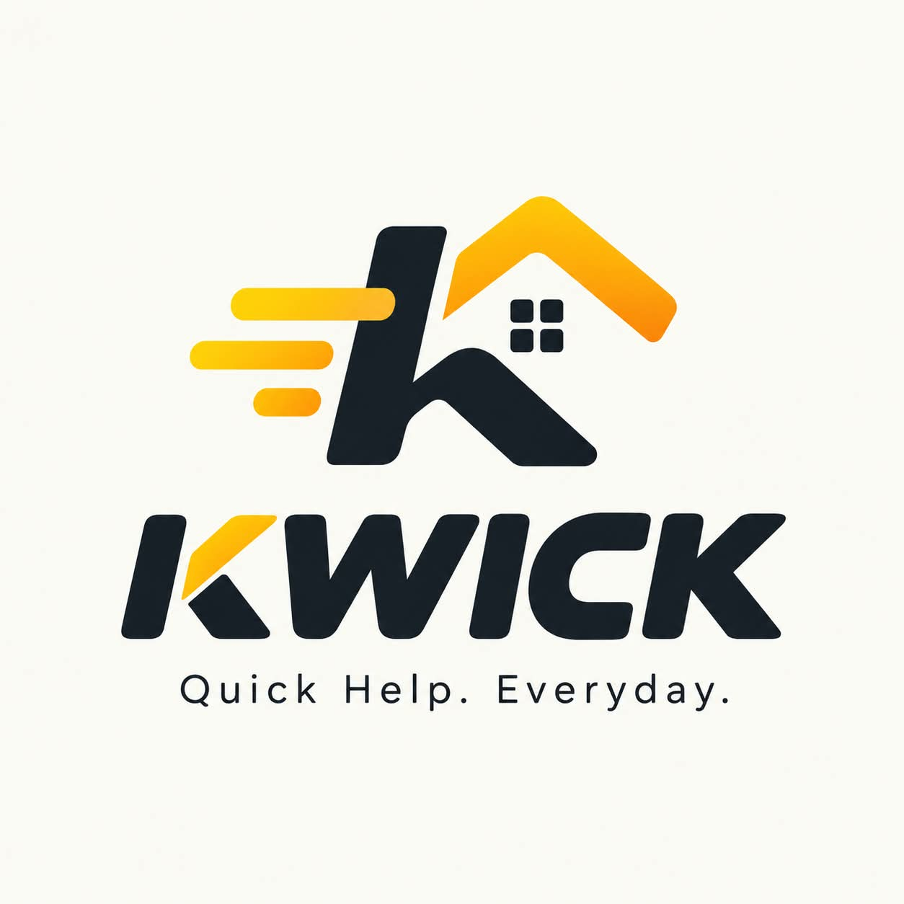
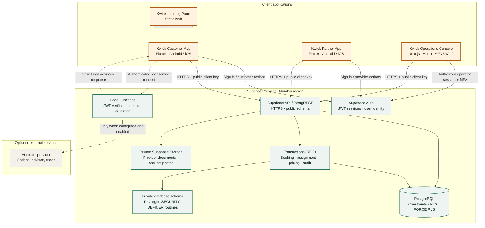
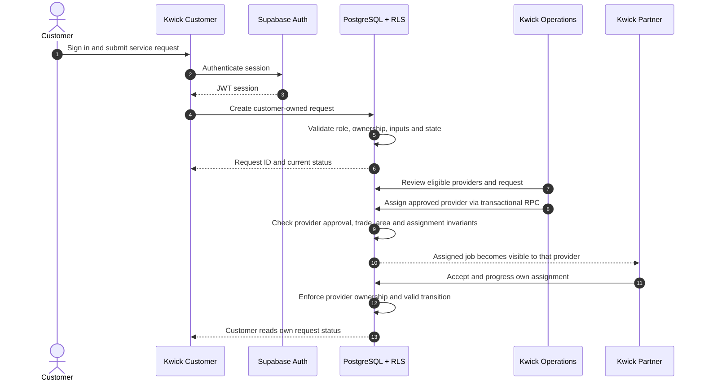

# Kwick — Trust-first home services marketplace

<p align="center">
  
</p>

<p align="center"><strong>Find the right local professional. Keep every service request accountable.</strong></p>

Kwick is a Bengaluru-focused home-services marketplace built around two separately installable mobile apps: **Kwick** for customers and **Kwick Partner** for service professionals. Both apps use one shared backend with database-enforced role boundaries. A separate operations console supports provider review, dispatch, disputes, and commercial approvals.

> **Project status:** Kwick is a pre-launch pilot build. The existing Supabase backend and migrations are live, and local app/admin/database validation has passed. Physical-device acceptance, the first admin account, off-site backup/restore, public repository access, and production deployment gates remain open. The initial HSR Layout service zone (560102) and plumbing/electrical categories are configured; targets of 100 customers and 30 providers are goals, not achieved traction.

## Product surfaces

| Surface | Purpose | Implementation |
|---|---|---|
| **Kwick** | Discover services, create requests, review quotes, track work, and leave reviews | Flutter · `lib/main_customer.dart` · Android `com.kwick.customer` |
| **Kwick Partner** | Provider onboarding, service/pricing management, assigned jobs, and job progression | Flutter · `lib/main_provider.dart` · Android `com.kwick.provider` |
| **Kwick Operations** | Provider verification, manual dispatch, dispute handling, fixed-price approval, and commission terms | Next.js 16 · TypeScript · `admin/` |
| **Kwick web presence** | Product information and pilot coverage | Static HTML/CSS/JS · `landing/` |
| **Platform backend** | Identity, authoritative data, access control, private files, transactional workflows, and optional server-side triage | Supabase Auth · PostgreSQL · RLS · Storage · Edge Functions |

## Architecture

The diagram below describes the implemented logical architecture. It is suitable for viewing directly in GitHub and capturing as a screenshot for a project submission.



### Booking and dispatch lifecycle



### Security boundaries

- **Identity:** Supabase Auth issues user sessions. The mobile apps contain only the public/publishable Supabase key; never place a service-role key, database password, or AI-provider key in a client bundle.
- **Authorization:** PostgreSQL is authoritative. RLS and `FORCE ROW LEVEL SECURITY` constrain customer, provider, and administrator access. Customer/provider roles are mutually exclusive for one account.
- **Booking:** Customer booking creation is database-guarded. Provider assignment and job progression require an approved provider and ownership of the assigned job.
- **Privileged operations:** Internal `SECURITY DEFINER` implementations live in a non-exposed `private` schema. Public RPC entrypoints are `SECURITY INVOKER` wrappers. Admin operations require administrator authorization and AAL2/MFA.
- **Files:** Provider verification documents and customer request photos use private Storage buckets with scoped access; document upload is not provider approval.
- **AI:** Optional issue triage is advisory. It cannot create bookings, assign providers, set prices, or change job state. It remains disabled until a Kwick-specific model key and data-processing approval are configured.
- **Logging:** Production client logs use sanitized event names. Do not log passwords, OTPs, tokens, full addresses, identity documents, or raw request payloads.

## Product and commercial rules

- The initial configured pilot is HSR Layout, Bengaluru (560102), with plumbing and electrical categories. Do not imply broader live coverage.
- Provider onboarding is not equivalent to verification. An authorized operator must review evidence and approve a provider before dispatch eligibility.
- Pricing supports provider quotes and negotiated fixed prices approved by operations before customer display.
- Commission is negotiated per provider/service category and recorded in basis points. No default percentage is assumed; active terms require provider agreement and admin approval.
- There is no monthly provider subscription in the initial pilot. Commission records do not mean payment collection or provider settlement is implemented.
- Monetary amounts are integer paise; commission rates are integer basis points (100 bps = 1%).
- Do not collect Aadhaar biometrics, full Aadhaar numbers, or Aadhaar e-KYC payloads.

## Repository layout

```text
Kwick/
├── lib/                         # Shared Flutter domain, UI and two app entrypoints
├── assets/branding/              # Kwick brand assets
├── android/                     # Customer and partner Android flavors
├── ios/                          # Customer and partner Xcode schemes
├── admin/                        # Next.js operations console
├── landing/                      # Public static product website
├── supabase/migrations/          # Versioned PostgreSQL schema and policy changes
├── supabase/functions/           # Server-side Edge Functions
├── supabase/tests/               # Database and authorization tests
├── test/                         # Flutter tests
├── scripts/backup/               # Encrypted logical backup/export tooling
├── scripts/load/                 # Read-only staging load smoke test
└── docs/                         # Architecture, security, launch and operations docs
```

## Technology

- **Mobile:** Flutter / Dart, Riverpod, GoRouter, Supabase Flutter SDK.
- **Operations:** Next.js 16, React, TypeScript, Supabase JS.
- **Data and identity:** Supabase Auth, PostgreSQL, Row Level Security, transactional SQL functions.
- **Files and server logic:** Supabase Storage and Edge Functions.
- **Quality:** Flutter analyzer/tests, PostgreSQL migration/RLS tests, Deno checks, Next.js lint/build, landing-page validator, GitHub Actions.

## Local development

### Prerequisites

- Flutter 3.44+ / Dart 3.12+
- Java 17
- Node.js 22+
- Supabase CLI
- Docker Engine for isolated PostgreSQL tests

### 1. Start local Supabase

```bash
supabase start
supabase db reset
supabase status
```

Use the local API URL and anon key printed by `supabase status`. For Android Emulator, use `http://10.0.2.2:54321`; for iOS Simulator, use `http://127.0.0.1:54321`.

### 2. Run Kwick Customer

```bash
flutter pub get
flutter run --flavor customer -t lib/main_customer.dart \
  --dart-define=SUPABASE_URL=http://10.0.2.2:54321 \
  --dart-define=SUPABASE_ANON_KEY=<local-anon-key>
```

### 3. Run Kwick Partner

```bash
flutter run --flavor provider -t lib/main_provider.dart \
  --dart-define=SUPABASE_URL=http://10.0.2.2:54321 \
  --dart-define=SUPABASE_ANON_KEY=<local-anon-key>
```

### 4. Run the operations console

```bash
cd admin
npm ci
cp .env.local.example .env.local
# Set NEXT_PUBLIC_SUPABASE_URL and NEXT_PUBLIC_SUPABASE_ANON_KEY
npm run dev
```

Open `http://localhost:3000`. Administrative actions require a provisioned administrator session with TOTP/AAL2. Do not use a normal customer account as an administrator.

### 5. Preview the landing page

```bash
cd landing
python3 -m http.server 4173
node validate.mjs
```

Open `http://localhost:4173`.

## Validation

Run from the repository root:

```bash
dart format --output=none --set-exit-if-changed .
flutter analyze
flutter test --coverage
./supabase/tests/run_tests.sh
npx --yes deno check supabase/functions/diagnose-service/index.ts
npx --yes deno test supabase/functions/diagnose-service/redaction_test.ts
npm --prefix admin ci
npm --prefix admin audit --audit-level=moderate
npm --prefix admin run lint
NEXT_TELEMETRY_DISABLED=1 npm --prefix admin run build
node landing/validate.mjs
```

Only report a check as passing after running it in the current environment. GitHub Actions may be unavailable if the account/repository spending limit blocks job startup; inspect the workflow run rather than assuming a green result.

## Android build identities

- Customer: `com.kwick.customer` — `customer` flavor — `lib/main_customer.dart`.
- Partner: `com.kwick.provider` — `provider` flavor — `lib/main_provider.dart`.

Debug builds are for development and device acceptance, not Play Store release. Signed release APK/AAB builds require the private upload keystore and the configured GitHub Actions signing/Supabase secrets. Never commit signing material.

```bash
flutter build apk --debug --flavor customer -t lib/main_customer.dart
flutter build apk --debug --flavor provider -t lib/main_provider.dart
```

The project is developed on Linux. iOS compilation, signing, provisioning, and TestFlight acceptance must be validated on a macOS/Xcode runner.

## Deployment and infrastructure disclosure

The existing backend is a Supabase project in Mumbai (`ap-south-1`). The admin and landing applications have deployment configuration, but stable production promotion and full operational acceptance are not complete. **Kwick is not currently deployed on Vultr.** Do not describe Vultr Cloud Compute, GPUs, Object Storage, VKE, or Load Balancers as part of the running architecture until a real Kwick component has been deployed and verified there.

The current backup process creates encrypted local logical exports. Off-site backup storage and a successful restore drill are still required. The current platform has not completed physical-device acceptance, production-equivalent load/soak testing, failover testing, or million-concurrent-user validation. See [Production Security & Operations](docs/PRODUCTION_SECURITY_OPERATIONS.md) and [Scale Readiness](docs/SCALE_READINESS.md).

## Documentation

- [Architecture](docs/ARCHITECTURE.md)
- [Database model and invariants](docs/DATABASE.md)
- [Security model](docs/SECURITY.md)
- [Production security, backups and launch gates](docs/PRODUCTION_SECURITY_OPERATIONS.md)
- [Scale readiness](docs/SCALE_READINESS.md)
- [Provider verification](docs/PROVIDER_VERIFICATION.md)
- [Commercial model](docs/COMMERCIAL_MODEL.md)
- [Bengaluru pilot playbook](docs/KWICK_LAUNCH_PLAYBOOK.md)
- [Operations runbook](docs/OPERATIONS.md)
- [Release guide](docs/RELEASE.md)
- [HackGlobal 2026 submission brief](HACKGLOBAL_SUBMISSION.md)
- [Contributing](CONTRIBUTING.md) · [Code of Conduct](CODE_OF_CONDUCT.md) · [Security policy](SECURITY.md) · [MIT License](LICENSE)

---

**Kwick — Home repairs, handled with care.**
