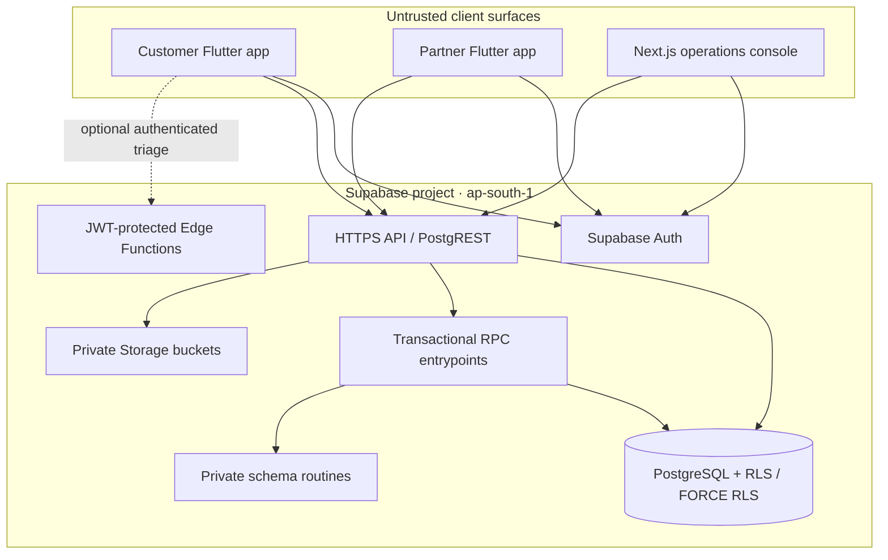

# Kwick Architecture

This document describes the implemented Kwick platform and its current deployment boundaries. The root [README](../README.md#architecture) contains the compact architecture diagram intended for repository visitors and hackathon screenshots.

## 1. System context

Kwick is a hyperlocal home-services marketplace with separate customer and provider mobile applications, a protected operations console, a public information site, and one shared transactional backend.

| Component | Runtime | Identity / entrypoint |
|---|---|---|
| Customer app | Flutter | `lib/main_customer.dart`; Android `com.kwick.customer`; iOS scheme `customer` |
| Partner app | Flutter | `lib/main_provider.dart`; Android `com.kwick.provider`; iOS scheme `provider` |
| Operations console | Next.js 16 / TypeScript | `admin/`; administrator session and AAL2/MFA for privileged operations |
| Landing site | Static HTML/CSS/JS | `landing/`; public product information, not a booking API |
| Backend | Supabase | Auth, PostgreSQL, Storage, Edge Functions; existing project in Mumbai (`ap-south-1`) |

The two mobile apps share domain models, services, UI components, and backend APIs, but have distinct app IDs, build entrypoints, and role-locked routes. App mode is fixed at build time. A customer build cannot navigate into provider-only screens and vice versa; PostgreSQL authorization independently enforces the data boundary.

## 2. Request path and trust boundaries



All clients are treated as untrusted. The public Supabase key identifies the project but does not grant elevated privileges. PostgreSQL policies, constraints, and function authorization are the security boundary.

## 3. Mobile application structure

```text
lib/
├── main.dart                 # Shared bootstrap / default entrypoint
├── main_customer.dart        # Customer application entrypoint
├── main_provider.dart        # Partner application entrypoint
├── app.dart                  # Shared app shell
├── core/
│   ├── config/                # App mode and runtime configuration
│   ├── routing/               # Role-specific route tables and guards
│   ├── theme/                 # Kwick design tokens
│   ├── validation/            # Input validation
│   ├── logging/               # Sanitized structured logging
│   └── utilities/             # Formatting and shared utilities
├── shared/
│   ├── models/                # Shared domain models
│   ├── services/              # Supabase client/service boundary
│   └── widgets/               # Reusable UI components
└── features/
    ├── auth/                  # Shared auth flow with app-mode checks
    ├── customer/              # Booking, history, reviews, support
    └── provider/              # Onboarding, pricing, assignments
```

Provider onboarding and document submission do not imply approval. The operator verification process is a separate state transition. Fixed-price proposals remain pending until administrator approval.

## 4. Backend data and invariants

- `auth.users` is the identity anchor. `profiles` stores profile information; `user_roles` records the account role.
- Customer and provider roles are mutually exclusive for one identity.
- Customer booking creation is restricted to customer-role accounts and customer-owned requests.
- Providers can access and progress only their own approved/assigned jobs.
- Provider approval, service eligibility, assignment ownership, and valid status transitions are checked in PostgreSQL.
- RLS and FORCE RLS are enabled across the public application tables.
- Customer reads are scoped to customer-owned records; provider reads are scoped to provider-owned/assigned records.
- Public RPCs are SECURITY INVOKER wrappers. Privileged SECURITY DEFINER implementations are held in the non-exposed `private` schema.
- Admin operations require database-side admin authorization and AAL2/MFA.
- Provider verification files and request photos are in private Storage buckets with scoped policies and temporary signed access.
- Monetary amounts are integer paise. Commission uses integer basis points (100 bps = 1%).
- Price proposals and commission terms are auditable. No default commission rate is assumed.

## 5. Optional AI triage boundary

`supabase/functions/diagnose-service/` is an authenticated server-side gateway. It validates the caller and input, applies usage controls, and can call a configured AI provider. The response is advisory and must be reviewed by the customer. The function does not create bookings, assign providers, set prices, or update job status. The Kwick-specific AI key is not currently configured; the function fails closed until explicit configuration and data-processing approval.

## 6. Operations and provider verification

The operations console supports provider document review, approval/rejection with audit notes, manual dispatch, dispute handling, fixed-price approval, and provider/category commission agreement recording. Provider verification should cover identity, reachability, trade competence, references, service-area fit, applicable licences, and a supervised pilot period. Do not request Aadhaar biometrics, full Aadhaar numbers, or Aadhaar e-KYC payloads.

## 7. Deployment and operational topology

- Existing Supabase project: Mumbai (`ap-south-1`).
- The admin and landing projects have deployment configuration, but stable production promotion and full authenticated acceptance are not complete.
- The current local encrypted backup timer is laptop-dependent. No off-site destination or successful restore drill is recorded.
- No custom Kwick load balancer, read replica, durable queue, or multi-region write topology is configured.
- Vultr is not currently part of the deployed Kwick architecture.

## 8. Scale path

Kwick is a pilot foundation, not a million-concurrent-user deployment. Keep a modular application and authoritative relational write model until measurements justify added complexity. Scale in evidence-driven stages: pooled connections and bounded queries; cache public catalogue reads; durable asynchronous queues for notifications/analytics; read replicas for eligible reads; partition high-volume event data; and consider regional read capacity or geographic write ownership only when required. Run staged load, soak, failover, and disaster-recovery tests on a production-equivalent environment before making capacity claims. See [Scale Readiness](SCALE_READINESS.md).

## 9. Initial launch boundary

The configured pilot area is HSR Layout, Bengaluru (560102). Plumbing and electrical are the initial active categories. Additional neighbourhoods and the 100-customer / 30-provider targets are plans, not current coverage or traction. Activate new areas only after provider coverage and operational support are verified.
