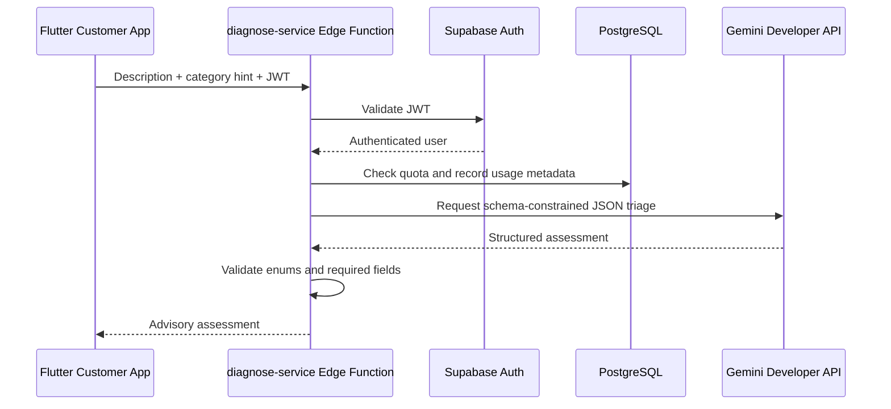
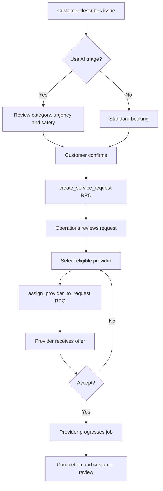

# NexHelp Architecture Specification

## 1. System Overview

NexHelp is a production-oriented home-services marketplace connecting customers with verified local service professionals (Plumbing, Electrical) in an initial Bengaluru pilot area. The system consists of:

1. **Flutter Mobile Application:** Unified codebase running role-based interfaces for Customers and Service Providers.
2. **PostgreSQL & Supabase Backend:** Authoritative source of state, security policies (RLS), transactional RPC procedures, and private file storage.
3. **Internal Operations Dashboard (`admin/`):** A protected Next.js web application for manual provider verification, assignment dispatch, order tracking, and dispute management.
4. **NexHelp Intelligence (`supabase/functions/diagnose-service/`):** An authenticated Gemini-powered Edge Function that returns structured, advisory issue triage.

```
+-------------------------------------------------------------+
|                      NexHelp Platform                       |
+-------------------------------------------------------------+
|                                                             |
|   +-----------------------+     +-----------------------+   |
|   |   Flutter Mobile App  |     |   Admin Dashboard     |   |
|   | (Customer & Provider) |     |  (Next.js TypeScript) |   |
|   +-----------+-----------+     +-----------+-----------+   |
|               |                             |               |
|               | PostgREST / RPC / Auth      | PostgREST/RPC |
|               v                             v               |
|   +-----------------------------------------------------+   |
|   |                 Supabase Engine                     |   |
|   |  - Supabase Auth (JWT & Roles)                          |   |
|  - Authenticated Edge Function gateway for Gemini      |   |
|   |  - PostgreSQL with Row-Level Security (RLS)         |   |
|   |  - Transactional Stored Procedures (SECURITY DEF.)  |   |
|   |  - Private Storage Buckets (Docs & Photos)          |   |
|   +-----------------------------------------------------+   |
|                                                             |
+-------------------------------------------------------------+
```

---

## 2. Flutter Mobile Application Architecture

The Flutter application follows a feature-oriented clean architecture:

```
lib/
├── main.dart             # Entry point, initializes Supabase and services
├── app.dart              # Root MaterialApp, theme, GoRouter binding
├── bootstrap/            # App bootstrap sequence, secure credentials setup
├── core/
│   ├── config/           # App configuration, environment variables
│   ├── errors/           # Failure models and exceptions
│   ├── routing/          # GoRouter definitions and role-based guards
│   ├── security/         # Storage and authentication token management
│   ├── theme/            # Color tokens, typography, component styles
│   ├── validation/       # Input validators (phone, address, pincode)
│   └── utilities/        # Formatting, date/time, currency helpers
├── shared/
│   ├── models/           # Shared models (UserRole, ServiceArea, Category)
│   ├── widgets/          # Buttons, form fields, cards, states
│   └── services/         # Client wrappers (SupabaseClient, PushClient)
└── features/
    ├── auth/             # Login, registration, password recovery, session
    ├── profiles/         # Profile viewing and editing
    ├── customer/
    │   ├── services/     # Category discovery and details
    │   ├── booking/      # Request creation and address confirmation
    │   ├── order_history/# Active orders, details, and cancellation
    │   └── reviews/      # Rating and feedback submission
    ├── provider/
    │   ├── onboarding/   # Documents, skill selection, verification status
    │   ├── availability/ # Available, busy, unavailable status toggling
    │   └── assignments/  # Offered jobs, accept/decline, progression
    ├── notifications/    # In-app notifications and device token sync
    └── support/          # Dispute and ticket submission
```

### Architectural Principles:
1. **Separation of Concerns:** Widgets are dumb rendering units emitting events. Riverpod Notifiers/Controllers manage presentation state and execute use cases.
2. **Authority of the Backend:** The client never unilaterally assumes an order is placed, accepted, or completed. All transitions are verified against PostgreSQL.
3. **Immutability:** State models are immutable; UI re-renders on distinct state transitions.
4. **Resilient Offline/Error Handling:** Network errors, validation errors, and authorization errors are clearly separated and presented to the user with actionable retry steps.

---

## 3. Database & Security Architecture

1. **Identity & Roles:**
   - Identity anchored in `auth.users(id)`.
   - `profiles` stores personal data (name, phone, avatar).
   - `user_roles` (`user_id`, `role`, `granted_by`) defines roles (`customer`, `provider`, `admin`, `super_admin`). Composite primary key.
   - Public clients cannot grant roles. Roles can only be granted via backend procedures or verified admin operations.

2. **Order Lifecycle & Invariants:**
   - State machine: `requested` -> `reviewing` -> `assigned` -> `accepted` -> `travelling` -> `in_progress` -> `completed`.
   - Terminal/Alternative states: `cancelled`, `disputed`.
   - **One Active Assignment per Request:** A partial unique index on `assignments(request_id)` for `status IN ('offered', 'accepted')` prevents duplicate active offers for a request.
   - **One Active Assignment per Provider:** A second partial unique index on `assignments(provider_id)` for `status IN ('offered', 'accepted')` prevents a provider from receiving overlapping active jobs.
   - **Financial Precision:** All amounts (`quoted_price_minor`, `final_price_minor`, `base_price_minor`) stored in integer paise.

3. **Row-Level Security (RLS):**
   - Enabled on 100% of exposed application tables.
   - Customers only access their own profiles, requests, authorized provider info on assigned jobs, and their submitted reviews.
   - Providers only access their own profile, verification status, active assignments offered to them, and necessary job details.
   - Unassigned providers cannot view customer addresses or phone numbers.
   - Admin access is checked through the self-scoped `is_admin()` helper and protected admin RPCs; `has_role(user_id, role)` is also scoped to the caller or an administrator.

4. **Transactional RPC Procedures:**
   - Multi-step operations (e.g., job assignment, acceptance, cancellation, state override) execute within atomic PostgreSQL functions with `SECURITY DEFINER`, schema-qualified references, and an empty `search_path` to reduce search-path injection risk.

---

## 4. Admin Operations Architecture

The internal dashboard is built with Next.js (App Router) and TypeScript:
- Communicates directly with Supabase via `@supabase/supabase-js`.
- Checks authenticated session against `user_roles` table. Non-admins are redirected immediately.
- Never embeds the Supabase `service_role` secret in the client bundle. Administrative procedures run under the authenticated admin JWT, adhering to admin RLS policies.
- Audit trail: Every administrative action (approval, rejection, suspension, manual assignment, status override) logs an immutable entry to `admin_audit_logs`.


---

## 5. NexHelp Intelligence — AI Triage

The optional AI pathway is implemented as a Supabase Edge Function. The Flutter client sends an issue description and optional category hint with the signed-in user's JWT. The function validates that JWT with Supabase Auth, enforces a per-user hourly quota, records usage metadata, calls the configured Gemini Developer API model, and validates the structured response before returning it.

The response contains:
- Suggested service category: plumbing, electrical, or other.
- Urgency: routine, soon, urgent, or emergency.
- Short issue summary and confidence label.
- Conservative safety alerts.
- Up to three follow-up questions.
- Dispatcher note.

The AI is advisory only. It cannot submit a booking, assign a provider, set a price, or change job status. Customers can submit a standard booking without AI. Raw issue descriptions are not stored in the AI usage audit table.

## 6. AI Request Sequence



## 7. Booking and Dispatch Flow



## 8. Dispatch Eligibility

The database assignment function is authoritative and requires an administrator caller, an assignable request, an approved provider, available status, matching service area, and an active provider-service mapping for the requested category. The operations UI ranks eligible candidates by published rating, completed jobs, and experience; the ranking does not replace server-side eligibility checks.

## 9. Deployment Boundary

The repository contains the app code, migrations, Edge Function, and deployment documentation. A dedicated NexHelp Supabase project, project-specific public configuration, server-side `GEMINI_API_KEY`, migration deployment, Edge Function deployment, and live end-to-end verification are still required before describing NexHelp as publicly deployed.
