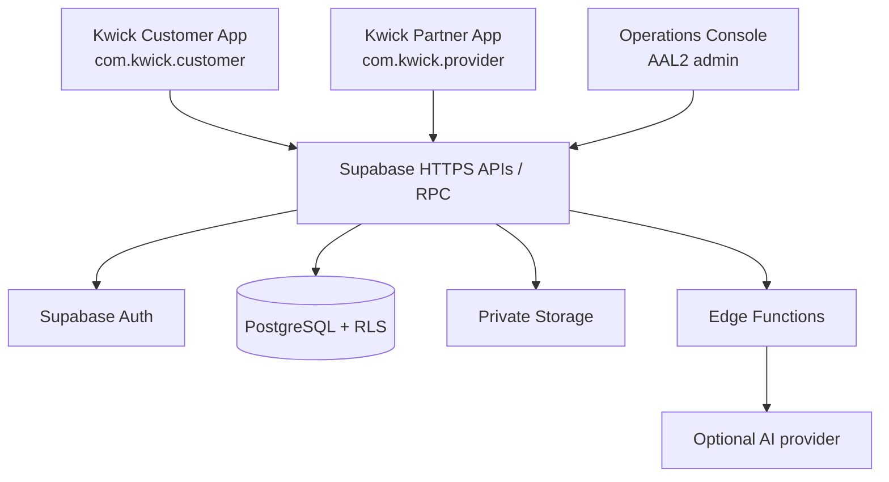

# Kwick Architecture

## 1. Platform overview

Kwick is a local home-services marketplace with two separate mobile applications and a shared transactional backend.

- **Kwick customer app** — `lib/main_customer.dart`, Android `com.kwick.customer`, iOS scheme `customer`.
- **Kwick Partner app** — `lib/main_provider.dart`, Android `com.kwick.provider`, iOS scheme `provider`.
- **Operations console** — protected Next.js application for provider review, dispatch, disputes, fixed-price approvals and commission agreements.
- **Supabase** — Auth, PostgreSQL/RLS, private Storage and Edge Functions.
- **Optional AI triage** — advisory only; it cannot create bookings, quote prices or dispatch providers.

The apps share domain models, services, themes and backend APIs, but have distinct entrypoints, install IDs and route sets. The app mode is fixed at build time; a customer app session cannot navigate to provider-only screens and vice versa.



## 2. Mobile application structure

```text
lib/
├── main.dart                 # Shared bootstrap and default customer entrypoint
├── main_customer.dart        # Customer application entrypoint
├── main_provider.dart        # Partner application entrypoint
├── app.dart                  # Shared MaterialApp shell
├── core/
│   ├── config/app_mode.dart  # Compile-time customer/provider role boundary
│   ├── config/app_config.dart
│   ├── routing/              # Role-specific route table and auth guards
│   ├── theme/                # Graphite/saffron Kwick design tokens
│   ├── validation/
│   └── security/
├── shared/
│   ├── models/
│   ├── services/             # Supabase client wrapper
│   └── widgets/
└── features/
    ├── auth/                 # Shared auth UI with app-mode-specific copy
    ├── customer/             # Discovery, booking, order history, reviews
    └── provider/             # Onboarding, private document upload, jobs, pricing
```

The provider app uploads identity/trade evidence to a private bucket and creates pending review records. Upload success is not provider approval. An operator must review the evidence and approve the provider before dispatch eligibility is granted.

The partner pricing screen supports provider-set job quotes and proposed fixed prices. A provider-submitted fixed price is forced to `pending`; only an administrator can approve it. Provider/category commission terms are separately visible to the provider and cannot be changed by the customer app.

## 3. Backend and transactional invariants

- `auth.users` is the identity anchor. `profiles` stores account data; `user_roles` stores customer/provider/admin roles.
- RLS scopes customer records to the customer, provider data to the provider and operational actions to an AAL2 administrator.
- Booking and assignment state transitions are enforced through PostgreSQL RPCs, not client-side optimistic status changes.
- Partial unique indexes prevent overlapping active assignments for a request and provider.
- All monetary values are integer paise. Commission is integer basis points (100 bps = 1%).
- Provider price proposals and approvals are append-audited. Commission terms are provider/category-specific, with no global default. An active commission term requires provider agreement evidence and admin approval.
- Customers can read only approved fixed catalogue prices. They cannot read private provider commission terms.
- Provider documents live in a private bucket with user-scoped paths and short-lived admin signed URLs.

## 4. Pricing and revenue model

Two service pricing modes are supported:

1. `provider_quote`: the provider prices the job after assessing scope.
2. `agreed_fixed`: a fixed price negotiated with the provider and approved by operations before customer display.

Kwick commission is not a hard-coded percentage. It is negotiated for each provider and service category. Draft terms are non-active. No monthly partner subscription is charged during the pilot. The current code records pricing and commission agreements but does not collect customer payments, deduct commission or settle provider payouts.

## 5. Operations and provider verification

The operations console supports provider document review, approval/rejection with audit notes, manual dispatch, dispute handling, fixed-price approval and commission agreement recording. Provider verification should include identity, reachability, trade competence, references, service-area fit, applicable licences and a supervised pilot period. Do not request Aadhaar biometrics, full Aadhaar numbers or Aadhaar e-KYC payloads.

## 6. Scale architecture

The current system is a pilot foundation, not a million-concurrent-user deployment. It uses a modular app and a transactional relational backend to avoid premature microservices. Scale work must be driven by measurements: connection saturation, database I/O, query latency, cache hit rate, queue lag, booking contention and cost per completed job.

The scale path is documented in [Scale Readiness](SCALE_READINESS.md): pooled connections and bounded queries first; then edge caching, read replicas and async queues; then partitioned event data, regional read capacity and geographic write ownership only when evidence justifies it. Million-user capacity requires staged load, soak, failover and disaster-recovery testing on a production-equivalent environment.

## 7. Current launch boundary

The only seeded service area is HSR Layout, Bengaluru, pincode 560102. Plumbing and electrical are the active pilot categories. Two or three Bengaluru neighbourhoods and 100 customers / 30 partners are launch targets, not current operating facts. Do not advertise other coverage until area records and verified partner capacity exist.
